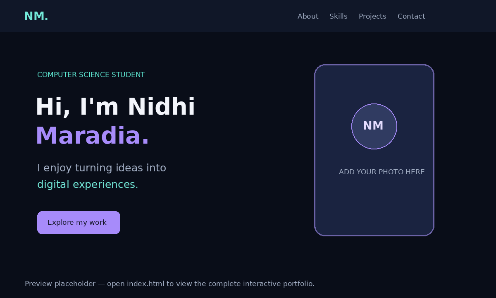

# Nidhi Maradia — Personal Portfolio

A responsive personal portfolio website created as a student project using HTML, CSS and JavaScript.

## About the portfolio

The website introduces Nidhi Maradia and includes:
- Home / introduction section
- About Me and education
- Skills
- Two sample projects
- Contact form with browser-side validation
- Responsive mobile navigation
- Dark / light theme toggle

## Technologies used

- **HTML5** — semantic page structure
- **CSS3** — styling, layout, hover effects and responsive media queries
- **JavaScript** — theme toggle, mobile menu and contact form validation

## Run the project locally

1. Download or clone this repository.
2. Open the project folder.
3. Double-click `index.html` to open it in a web browser.

For a convenient development workflow, open the folder in Visual Studio Code and use the Live Server extension.

## Screenshot

Add a fresh screenshot of your finished website in this folder and name it `screenshot.png`. Then this image will appear below in the GitHub README.



## Personalise before submitting

- Replace the profile-photo placeholder in `index.html` with your own image if you want to include one.
- Add your real email address only if you are comfortable making it public. Do not add your phone number or home address.
- Update the project descriptions and add project links/screenshots when your work is ready.
- Add your college roll number to the repository name if your teacher requires it. The roll number is intentionally not included in this starter project because it was not provided.

## GitHub repository and commits

Create a **public** repository named `Name_RollNo_Portfolio` (replace `Name` and `RollNo` with the required values). Upload these project files:

- `index.html`
- `style.css`
- `script.js`
- `README.md`
- `screenshot.png`

Make at least five separate commits with meaningful messages. Suggested sequence:

1. `Created portfolio HTML structure`
2. `Added navigation and portfolio sections`
3. `Styled portfolio with responsive CSS`
4. `Added theme toggle and mobile navigation`
5. `Added contact form validation`
6. `Added README and portfolio screenshot`

### Push using Git (after creating an empty GitHub repository)

Open a terminal inside this project folder and run:

```bash
git init
git add index.html
git commit -m "Created portfolio HTML structure"

git add style.css
git commit -m "Styled portfolio with responsive CSS"

git add script.js
git commit -m "Added interactive JavaScript features"

git add README.md screenshot.png
git commit -m "Added README and portfolio screenshot"

git branch -M main
git remote add origin https://github.com/YOUR-USERNAME/Name_RollNo_Portfolio.git
git push -u origin main
```

These commands create four commits. To meet the assignment requirement of at least five, make another meaningful change (for example, personalise the About section), then run:

```bash
git add index.html
git commit -m "Personalised portfolio introduction"
git push
```

Replace `YOUR-USERNAME` and the repository name with your actual GitHub details.

## Optional: publish with GitHub Pages

1. Open your repository on GitHub.
2. Go to **Settings → Pages**.
3. Under **Build and deployment**, choose **Deploy from a branch**.
4. Select the `main` branch and `/ (root)` folder, then save.
5. Wait for GitHub Pages to publish the site. Copy the live URL shown there and add it to this README.

## Important note about the contact form

The contact form currently validates the visitor's entries in the browser and displays a confirmation message. It does **not** send or store messages. A backend or a form service is needed to receive real submissions.
